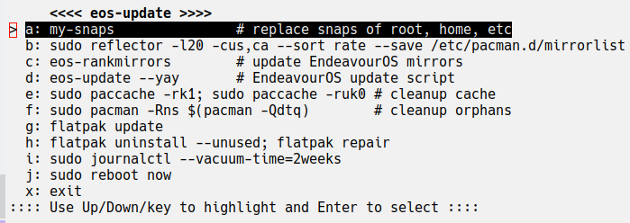

# rungs — interactive menus for fuzzy Linux procedures

`rungs` turns a plain `.ini` file into a keyboard-driven menu for running shell commands — one **rung** at a time up the ladder of a procedure. It is built for *fuzzy* procedures on Linux, where the exact steps depend on what you encounter: **skip** steps whose preconditions are already met, and **repeat** steps that failed. Mnemonic: step through the **rungs** of your laddered procedure.



Typical configs are **system updates**, **Docker housekeeping**, and other chores with "too many commands to remember". It also makes a good **executable runbook**.

## What you get

* **Fuzzy, not fixed** — a procedure is a menu, not a script; you decide what runs next.
* **Tiny & self-contained** — pure Python standard library, no dependencies, one `.ini` file holds every menu.
* **Nothing to remember** — commands live in a readable config; the menu shows a description for each.
* **Composable** — menus can launch other menus, so multi-level procedures are easy.
* **Section environment & preambles** — `+ENV` sets variables every command in a section sees; `+PRE` prepends shell text (variables, helpers) to each command.
* **Recoverable** — every valid config is backed up to `rungs.ini.bak`; a corrupt one drops you into the edit menu.
* **Escapes cleanly** — at the menu, one <kbd>Ctrl</kbd>+<kbd>C</kbd> is swallowed with a hint (press it again to exit); while a command runs it interrupts *that command only* (reported as status `130`) and returns you to the menu.

## Install

`rungs` needs Python **3.11+** and a POSIX-ish terminal (it reads keys via `termios`). [`pipx`](https://pipx.pypa.io/) keeps it isolated:

```sh
pipx upgrade rungs || pipx install rungs
```

Plain `pip` works too: `python3 -m pip install --user --upgrade rungs`.

## Quick start

```sh
rungs                 # list all your menus, then pick one
rungs eos-update      # run a menu by name (fuzzy-matched)
rungs my-procedure    # run an .ini file directly (any filename)
rungs --dry-run       # show the commands without running them
rungs --help          # the full command line
```

Menus live in `~/.config/rungs/rungs.ini`, which `rungs` creates on first run. A menu is a section; each entry is `key: command`:

```ini
[eos-update]
a: my-snaps                                 # replace snaps of root, home, etc.
b: sudo reflector -l20 -cus,ca --sort rate --save /etc/pacman.d/mirrorlist
c: eos-rankmirrors                          # update EndeavourOS mirrors
d: eos-update --yay                         # EndeavourOS update script
e: sudo paccache -rk1; sudo paccache -ruk0  # cleanup cache
x: exit
```

Type the key (or move with <kbd>↑</kbd>/<kbd>↓</kbd>) and press <kbd>Enter</kbd> to run it; afterwards the **next** entry is pre-selected, so <kbd>Enter</kbd> continues while picking any other entry skips or repeats. Long menus fold out-of-view entries into a `<<<<<<< a..e` row that re-opens as you approach it.

Config notes:

* For long commands, put a **description on the first line** and the command on the **indented lines** that follow — the menu shows the description, bash receives the rest literally.
* Keys must be unique per menu. A **one-character** key is used literally (`a: add`), so make it a mnemonic. A **longer** key is only a placeholder: `rungs` assigns it the next free display character in file order, leaving `x` free for the exit entry (`00: git fetch --all` → `b`).
* `exit` (or `quit`) closes the menu; by convention it sits on `x`. Without it, leave with <kbd>Ctrl</kbd>+<kbd>C</kbd> twice.
* A section can open a shared `+ENV` block (one `NAME=VALUE` per line; `$VAR` expanded once) and a `+PRE` block (shell text, handed over verbatim, echoed once). Both apply to the whole section and are inherited by sub-menus.
* `[__GLOBAL__]` is a hidden section that accepts only `+ENV` and `+PRE`, and is inherited by every menu.

## Executable runbooks (stepped specs)

For procedures too fuzzy for a script but too important for a wiki page, a **stepped spec** proves the product actually wired itself into the box — `$PATH`, the launcher, the systemd unit, `sudo` — which mocks never see. Each step prints its evidence and an `EXPECT:` line, then a one-line verdict pulled from `$OK_MSG` / `$FAIL_MSG`, so the same run serves the human reading it and the CI job grepping it:

```ini
[__GLOBAL__]
+ENV: OK_MSG=✓✓✓✓✓✓✓✓✓✓ OK
      FAIL_MSG=✘✘✘✘✘✘✘✘✘✘ FAIL

[smoke]
01: :: *Install the working tree          # state-changing; '*' butts the text
   pipx install --force .
02: ::  - CHK: launcher is on PATH. EXPECT: a resolved path
   echo '$ command -v mytool'
   command -v mytool
   command -v mytool >/dev/null 2>&1 \
     && { echo; echo "$OK_MSG"; } \
     || { echo; echo "$FAIL_MSG"; exit 1; }
x: exit
```

The example shows the pieces off: a placeholder key (`01`, `02`) auto-lettered, leading `::` marking a title/evidence line, `+ENV` supplying shared verdict text, and a multi-line command sent to bash literally.

Run it (needs a TTY, and a human for the risky steps), then let CI read the verdict from the captured log:

```sh
rungs samples/IntegrationSpec.ini | tee run.log
grep -q '✓✓✓' run.log && echo PASS || echo FAIL
```

The TTY-and-human requirement is the point: use it *alongside* your mocked unit tests, not instead of them. See [`samples/IntegrationSpec.ini`](samples/IntegrationSpec.ini).

## Samples & recipes

Ready-to-adapt menus in [`samples/`](samples/) cover the common shapes:

* [`UbuntuUpdateUpgrade.ini`](samples/UbuntuUpdateUpgrade.ini) — `apt`/`snap`/`flatpak` update plus a two-level LTS release upgrade.
* [`FedoraUpdateUpgrade.ini`](samples/FedoraUpdateUpgrade.ini) — `dnf` update plus a two-level Fedora release upgrade.
* [`DockerMaintenance.ini`](samples/DockerMaintenance.ini) — reclaim Docker disk space (images, containers, volumes, build cache).
* [`IntegrationSpec.ini`](samples/IntegrationSpec.ini) — the stepped spec above.

These are not tested against the latest distro releases — review them before running.

Recipe outlines to build your own:

* **System update** — mirrors → package manager update → flatpak → cache/orphan cleanup → reboot.
* **Docker housekeeping** — `docker system df` → prune images/containers/volumes → `docker system prune` → review leftover networks.
* **Onboarding a machine** — snapshots → config sync → dotfiles → reboot.

## License

MIT — see [LICENSE](LICENSE).
